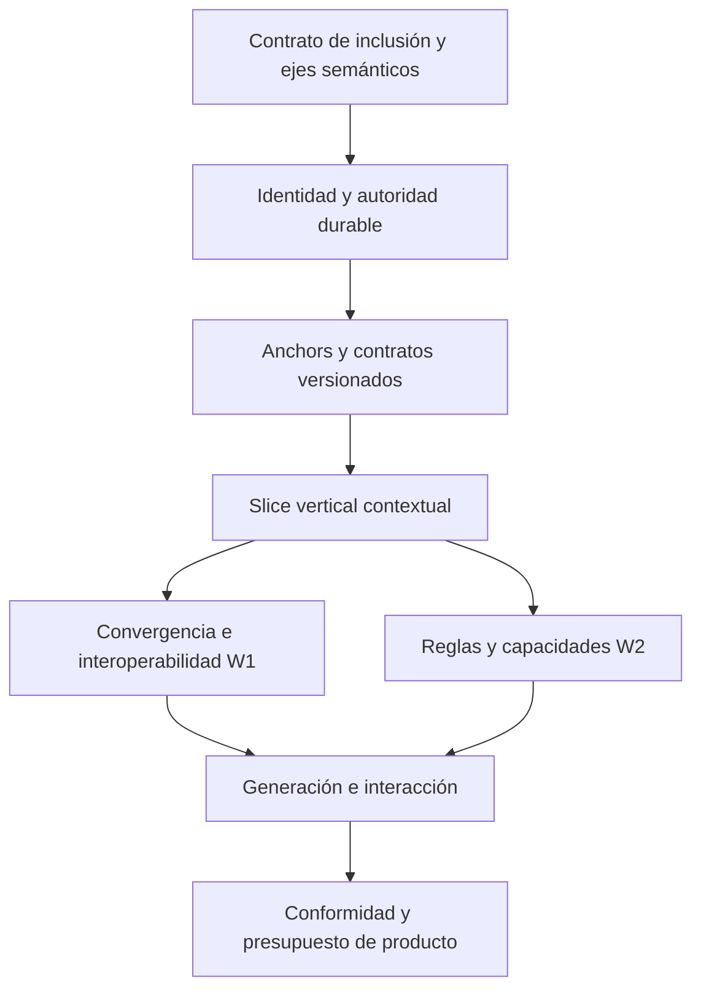

# P5 — Plan de inclusión y gates

Estado: **propuesta**. El resultado de esta revisión es documental; no se ejecuta esta implementación ni se cambia la prioridad del dueño automáticamente.

## Dependencias

La optimización del store acompaña el slice C/D con mediciones; no requiere esperar a todo G ni debe posponer indefinidamente una prueba contextual de extremo a extremo.

## Tareas concretas

| tarea | entregable revisable | depende | gate |
|---|---|---|---|
| T01 | Manifest C01–C28 y excepciones; actualización propuesta de README/FAQ/12 | — | Cada required tiene fixture y comportamiento; drafts no figuran como implementados |
| T02 | ADR verdad/sentido/soporte/revisión; reemplazo de `:status` ambiguo | T01 | Casos false, unknown, unsinnig, anclado/derivado y source vs realidad |
| T03 | ADR contenido/ocurrencia/símbolo/contexto; moves y nombres cualificados | T01 | Duplicación A/B, homónimo Curie/Franklin, README duplicados |
| T04 | Contrato base/grafo y durable inputs; lint de independencia | T02/T03 | Borrar caché no pierde datos fuente ni decisiones |
| T05 | Contratos de parser/selector con mapas de spans | T03/T04 | Unicode/markup/multihoja y misma raíz bajo contrato fijo |
| T06 | IR lógico y validación contextual | T02/T03 | Reglas anidadas/negativos de aridad y scope |
| T07 | Protocolo semántico, wrapper de motor referencia y validación de inputs | T05/T06 | FakeBackend; cero red; timeout/malformed/hash stale sin commit |
| T08 | Slice source→G→ask/why→edición→reconciliación | T04–T07 | Respuesta con soporte; stale local; mismo resultado tras cold rebuild |
| T09 | Convergencia en pares/lotes, canonicalización contextual | T08 | Sintético + corpus offline; igualdad numeric oracle; falsas fusiones y cobertura |
| T10 | Deducción con pruebas AND/OR y mantenimiento | T08 | Conjunción, alternativa, retractación transitiva y ciclos |
| T11 | W2 orden, término medio, shape, esquemas y reflexión | T08/T10 | Fixtures de ocho módulos, incluyendo negativos adicionales |
| T12 | Generación y snapshots completos | T04/T10/T11 | Regeneración desde instancia; export/import conserva contexto y pruebas |
| T13 | Aclaraciones/foco/sesiones por API | T08 | Pending ligado a revisión; elección obsoleta no ejecuta acción |
| T14 | Conformidad final y paquete instalable | T09–T13 | Todos required cerrados, rendimiento acotado y excepción publicada |

T04/T08 incluyen recovery de writes y before-image sobre archivos; T14 distingue bundle de base de paquetes semánticos y prueba instalación, versiones y capability unavailable. Estas garantías no se deducen de que `TransactionPlan` sea atómico dentro del store.

Un task, un commit; evidencia bajo `runs/subagents/`. Las tareas de implementación se ejecutan por el flujo herdr pi del repositorio. Esta tabla es backlog propuesto; no modifica el Board legacy.

### Cruce con el backlog vigente de `12 §1`

T01 es documentación independiente; T03 y cualquier implementación de identidad esperan D0/K1. T04 se alinea con P1/K2a y puede avanzar por su frontera sin decidir D0. T05 se alinea con S1/S2 (S2 espera K1); T06–T11 pertenecen a G1 y sus derivados, y respetan D0/M1 como prerrequisitos de implementación. Generación se alinea con M1/M2, que no restaura modelos legacy. T14 suma packaging/cliente a C2. Ninguna tarea de esta propuesta autoriza saltarse una dependencia o implementar una decisión abierta.

## Fixtures mínimos compartidos

| fixture | prueba principal | control negativo |
|---|---|---|
| Curie/Franklin | Referente contextual y proyección revisada | `she` homónimo jamás se fusiona por cadena |
| Vegetales | Máscara, compuertas, D_i y refinamiento | Puertas de zanahoria inadmisibles; ausencia no implica falso |
| Cadena con falso | FALSE explícito vs UNKNOWN | Calificar ID no pierde el falso |
| Dos sources con párrafo igual | Invalidación por ocurrencia | Editar A no rompe B |
| Regla con alternativa | Derivación, retractación y why | Perder una prueba no elimina otra; ciclo no crea raíz |
| Dos relaciones con término medio | Composición y witness | Tramo TRUE+unsinnig corta ruta |
| Regla con `?x` | Universo finito/contexto | No crear símbolo literal `x`; grounding acotado |
| Instancia generada | Dos estilos, mismo conocimiento | Editar output no muta instancia silenciosamente |
| Función de código + prueba | Anchor estructural y alcance de resultado | Test verde no prueba afirmaciones ajenas al contrato |
| Source Unicode | Cita raw verificable desde spans NFC | No redondear offset ni aceptar hash stale |

## Rendimiento y calidad

Separar cold/warm, bytes durables/caché/inputs, tiempo de parse/extracción/compilación/evaluación, tamaño de ejes/pares/ground instances, memoria pico, rutas recorridas y número de tareas invalidadas. Comparar optimización contra resultado+prueba, no solo contra hashes.

Para corpus: medir condiciones necesarias de alcance antes de QA; oro independiente; positivos sintéticos y negativos; configuración y semilla fijas; declaraciones LLM cacheadas; no llamadas online. Reportar todas las consultas, incluidas unranked/missing. No fijar umbral de QA a partir del resultado de la misma corrida: elegirlo antes del experimento y justificarlo por caso de uso.

Límite inicial de evaluación externa: 4 GB por comando, timeout y resultados parciales. El presupuesto final del producto se decide con datos; 4 GB es protección de la corrida, no una garantía de rendimiento de Kimun.

## Gate de cero contexto para los nuevos specs

Una persona que solo lee el spec debe poder responder: qué persiste, qué identifica, dónde está la autoridad, cómo resolver un símbolo, qué invalida una respuesta, qué pasa al borrar caché/source, qué diferencia FALSE/UNKNOWN/unsinnig, cómo se acepta una correspondencia y cómo se demuestra una derivación. Cada respuesta debe tener un ejemplo y una prueba de aceptación.

## Criterio de cierre del objetivo

Se declara superset únicamente cuando el manifest de P1 está cerrado para todos los required, cada diferencia frente a W está documentada, los negativos de R2 se satisfacen, reconstrucción y export/import no pierden autoridad y los paquetes soportados pueden operar bajo su presupuesto. Una suite documental de v1 en verde y un adaptador que emite triples no cierran ese objetivo.
