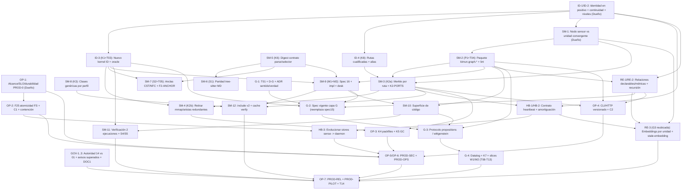

# Inventario exhaustivo de tareas para terminar `kimun` (Agy — 2026-11-14)

> **Alcance y estado epistémico (solo lectura):** Este inventario consolida las tareas pendientes en [`docs/v2/12-ecosistema-y-pendientes.md`](file:///home/jp/proyectos/kimun/docs/v2/12-ecosistema-y-pendientes.md), [`docs/v2/05-estado.md`](file:///home/jp/proyectos/kimun/docs/v2/05-estado.md), [`docs/v2/14-juego-del-lenguaje.md`](file:///home/jp/proyectos/kimun/docs/v2/14-juego-del-lenguaje.md) (cabeceras 2026-11-14), [`auditoria-spec.md`](file:///home/jp/proyectos/kimun/runs/research/2026-11-14/concilio/auditoria-spec.md), [`ambiguedades.md`](file:///home/jp/proyectos/kimun/runs/research/2026-11-14/concilio/ambiguedades.md), [`roadmap-produccion.md`](file:///home/jp/proyectos/kimun/runs/research/2026-10-13/concilio/produccion/roadmap-produccion.md), [`spec-final-candidato.md`](file:///home/jp/proyectos/kimun/runs/research/2026-10-13/concilio/produccion/spec-final-candidato.md), [`05-roadmap-and-gates.md`](file:///home/jp/proyectos/kimun/docs/reviews/wittgenstein-superset/proposals/05-roadmap-and-gates.md), [`Board.md`](file:///home/jp/proyectos/kimun/desk/tasks/Board.md) y [`EVIDENCE.md`](file:///home/jp/proyectos/kimun/runs/subagents/2026-11-14-sense/EVIDENCE.md).
> **Reglas:** No establece prioridades (solo dependencias; cf. `12 §1` y `AGENTS.md`). Etiqueta explícitamente:
> - **`[DECISIÓN DUEÑO]`** — puerta que solo el dueño puede cerrar; **prohibido** implementarla por inferencia.
> - **`[DISEÑO/PROPUESTA]`** — especificación abierta o ambigüedad por formalizar.
> - **`[CÓDIGO/MIGRACIÓN]`** — implementación o refactorización con contrato previo.
> - **`[OPERACIÓN/EVIDENCIA]`** — endurecimiento, documentación, seguridad, empaquetado o piloto.
> **Nota:** En `runs/subagents/2026-11-14-sense/` existe ya un primer corte de `kimun stores sense [--once]` (observación diagnóstica *read-only*, aún no es *heartbeat* ni cubre toda mutación topológica).
> **Invariantes transversales de cierre (`AGENTS.md`, `12 §1`, `03`):** `bb lint` (anillos + docstrings), `bb test` bajo `memcap`, `bb oracle`, paridad v1 estricta (`scripts/parity/coverage.py`), `bin/kimun include check`, un commit por tarea con evidencia en `runs/subagents/`.

---

## 0. Desbloqueo normativo y huecos respecto de `12 §1`

Antes o en paralelo al diseño técnico, `auditoria-spec.md` detecta huecos que impiden saber qué documento manda:

| ID | Tipo | Tarea | Depende de | Criterio de cierre observable | Origen |
|---|---|---|---|---|---|
| **GOV-1** | `[DISEÑO/PROPUESTA]` | Resolver conflicto de autoridad `14` vs `01 §2, §4.3` y ejecutar `DOC1`: integrar adendas `14 §16–§21`, separar contrato vigente / implementado / histórico y corregir error de `06` («check abre por replay»). | — | Tabla de autoridad en `docs/v2/README.md` sin contradicciones; `14` declara explícitamente qué secciones de `01`/`02`/`05`/`07`/`11`/`12` revisa; enlaces validados. | `12 §1` DOC1; `auditoria-spec.md` §4, §7 |
| **GOV-2** | `[DISEÑO/PROPUESTA]` | Marcar documentos y filas superadas por la dirección 2026-11-14: `14 §21` y recuadro «cómo leer», cabeceras `01`/`02`, `05` dec. 1/4/46, `12 §1` filas `D0`/`K1`/`G3`, `drafts/{preguntas-abiertas,fuentes-identidad,ids-desde-matrix}.md`, `AGENTS.md`, `README.md`, `00 §3.3`, más avisos en `unidad-{claude,pi,agy}.md`, `autopoiesis-*.md` y `pi.md`. | — | Todo archivo con texto previo a 2026-11-14 lleva aviso explícito distinguiendo mandato vigente de texto histórico/superado. | `auditoria-spec.md` §4–§5, §7 |
| **GOV-3** | `[DECISIÓN DUEÑO]` | Decidir si las acotaciones del coordinador (`embedding ≠ identidad`, `similitud continua ≠ relación validada`, no auto-reparar sin declaración) entran como mandato en `14` o permanecen hipótesis abiertas. | — | Registro explícito en `docs/v2/05-estado.md` o cabecera de `14`. | `auditoria-spec.md` §0, §7; `ambiguedades.md` |

### Resumen de huecos detectados entre `12 §1` y la dirección vigente (2026-11-14)
1. **`D0`/`K1` desalineadas:** `12 §1` sigue diciendo «identidad = lugar» / «ids por lugar», contradiciendo las cabeceras de `14` (`identidad ≠ hash`, `identidad ≠ anclaje topológico`).
2. **Secuencia invertida en `G3` y `roadmap-produccion`:** `12 §1` ubica embeddings (`G3`) después de `G1`, y `roadmap` mete `G` en Gate A; la dirección 2026-11-14 exige cerrar `S–M` antes de `G` y define la unidad con sentido discreto, semántico, estructural **y embeddings continuos**.
3. **Ausentes totales en `12 §1`:** *heartbeat* y activación asíncrona, taxonomía de relaciones de unidad (`jerárquicas/horizontales/métricas/recursivas`), ejecuciones marcadas (Verificación 2 más allá de `05 §1` S4/S5), retención selectiva de evidencia ante `drifted` sin CAS global, atomicidad FS↔store (`F25`), `CODE-SURFACE`, `G-INGEST`, `G-LI`, `K2-PORTS`, `CACHE-VERIFY`, `F2-ANCHOR`, `PROD-*` (seguridad, operación, SLO, release, piloto).
4. **Deuda del `Board.md` sin mapear a gates:** `hardening_test.cljc` (contención en mismo árbol sobre `heads`), `Clock` port / monotonicidad ULID, cobertura (`cloverage`) + corrida JVM.

---

## 1. Identidad y continuidad temporal

| ID | Tipo | Tarea | Depende de | Criterio de cierre observable | Origen |
|---|---|---|---|---|---|
| **ID-1** (`D0` revisada) | `[DECISIÓN DUEÑO]` | Definir en positivo la «identidad propia» del nodo/unidad y su representación (`ID` de nacimiento vs coordenada genética + linaje vs `ID` opaco + alias direccionable; `A2.1`), más la frontera entre «unidad» y «unidad de anclaje leaf+grafemas» (dec. 32). | — | Tabla de identidad por tipo de entidad (unidad, ancla en `S`, arista, revisión, huella de estado) y política de alias aprobada en `05`/`14`. | `14` cabecera; `spec §3.3`; `ambiguedades.md` A2.1; `auditoria-spec` §2 |
| **ID-2** | `[DECISIÓN DUEÑO]` | Definir contrato de continuidad temporal y niveles de abstracción (`L0–L4` o recursión equivalente): reglas para creación, duplicación concurrente, movimiento, edición, `split`, `merge`, borrado y recreación, y quién/cuándo declara continuidad (`A2.2`). | `ID-1` | Matriz de transiciones y fixtures discriminantes (p. ej. mover+editar con candidato homónimo; dos agentes marcando la misma función sin sincronizar). | `14` cabecera; `spec §3.3`; `ambiguedades.md` A2.2; `agy.md` |
| **ID-3** (`K1` + `T03`) | `[CÓDIGO/MIGRACIÓN]` | Implementar nuevo esquema de identidad en kernel (`node.cljc`, `edge.cljc`, `revision.cljc`, `reconcile.cljc`), separar huellas de estado Merkle de IDs de entidad, actualizar `bb oracle` (`scripts/canon_oracle.py`) y puerto `Clock`/ULID (`Board.md`). | `ID-1`, `ID-2` | `bb oracle` nuevo en verde; `reconcile` emite propuestas fuera del pool y preserva pérdida explícita de soporte; fixtures de duplicado/movimiento/split/merge/homónimos en verde. | `12 §1` K1; `T03`; `Board.md`; `spec §3.2–3.3` |
| **ID-4** (`K8`) | `[DISEÑO/PROPUESTA]` + `[CÓDIGO/MIGRACIÓN]` | Definir y aplicar nombres cualificados por ruta con alias corto no ambiguo (decidiendo su rol como localizador/alias y no identidad): normalización, case por OS, percent/Unicode, referencias `Model:doc`, `st.*` y enlaces federados. | `ID-1` (para fijar que ruta = localizador/alias, no ID) | Pruebas de homónimos (`a/README.md` vs `b/README.md`) y rename en `include`, CLI, links, export y adaptadores sin colisiones ni ambigüedad silenciosa. | `12 §1` K8; `spec §5.4`; `auditoria-spec` §2 |

---

## 2. Frontera S–M (sensorización, modelos, parsers, store estable y ejecuciones)

| ID | Tipo | Tarea | Depende de | Criterio de cierre observable | Origen |
|---|---|---|---|---|---|
| **SM-1** | `[DECISIÓN DUEÑO]` | Resolver arquitectura de nodo sensor vs unidad (`A1.1`: nodo único convergente con facetas de anclaje vs bipartición nodo sensor ↔ nodo unidad) y en qué lado de la frontera `P1` vive cada parte (`14 §19` vs unidad convergente). | `ID-1` | ADR aprobada especificando qué persiste en store estable, qué en cache recomputable y qué en el paquete grafo. | `ambiguedades.md` A1.1; `auditoria-spec` §4 (`14 §19`) |
| **SM-2** (`P1` + `T04`) | `[CÓDIGO/MIGRACIÓN]` | Separar grafo (`kimun.graph.*`: modelos, aristas relacionales, capa G) de la base/sensorización, definir API pública entre capas, partir `kimun.surface.docs` y agregar regla de anillo en `bb lint`. | `SM-1` | `bb lint` falla si base/kernel importa `kimun.graph.*`; superficies actuales mantienen contrato hasta versionado. | `12 §1` P1; `T04` |
| **SM-3** (`K2a` + `K2-PORTS`) | `[DISEÑO/PROPUESTA]` + `[CÓDIGO/MIGRACIÓN]` | Implementar store estable con Merkle **por ruta** exclusivamente sobre lo *trackeado*, registro mínimo, sacar plan de build del CAS, adaptar `LazyMaps`/`ObjectCache`/`heads-memo`/`commit-tx!` y decidir retención acotada de evidencia `drifted` (`A1.3`). | `ID-4`, `SM-1` (coordina con `SM-2`) | Reconciliación incremental baja solo por ramas cambiadas; borrar `<store>/cache/` y reconstruir reproduce exactamente huellas; store no guarda copia CAS de todo el ambiente. | `12 §1` K2a; `spec §5.2`; `ambiguedades.md` A1.3; `roadmap` K2-PORTS |
| **SM-4** (`K2b`) | `[CÓDIGO/MIGRACIÓN]` | Retirar índice mmap por IDs internos y las tres aristas redundantes por documento en store estable. | `ID-3`, `SM-3` | `stores verify` y recuperación/rebuild sin mapa mmap legado; cobertura de pruebas de reachability y formato en verde. | `12 §1` K2b |
| **SM-5** (`K6`) | `[DISEÑO/PROPUESTA]` + `[CÓDIGO/MIGRACIÓN]` | Formalizar digest de contrato de parse/normalización/selector/perfil/clase en caché y distinguir diagnósticos `source-changed`, `contract-changed`, `parser-unavailable` y `rebuild-mismatch`. | — | Fixtures negativos y positivos por cada categoría de drift; caché expirada o borrada con contrato fijo reconstruye idéntico. | `12 §1` K6; `spec §6.2` |
| **SM-6** (`S1`) | `[CÓDIGO/MIGRACIÓN]` | Cerrar ~3 % de divergencia entre `kimun.surface.markdown.cst-ast` (tree-sitter) y parser nativo en Markdown libre; evaluar cambio de default de `KIMUN_PARSER`. | `SM-5` (antes de cambiar default) | Paridad CST/AST documentada en corpus libre + propiedades; pod tree-sitter pinado y reproducible. | `12 §1` S1; `04 §11.2`; `roadmap` S1 |
| **SM-7** (`S2` + `T05`) | `[CÓDIGO/MIGRACIÓN]` | Anclas por rango de bytes / nodos del CST con mapeo inequívoco a hojas + grafemas NFC y solución a anclas externas sin posición (`F2-ANCHOR`). | `ID-3`, `SM-5` | Fixtures Unicode NFC multilínea/multihoja; reconciliación de ancla externa intacta, cambiada y eliminada sin caer en `orphan` espurio. | `12 §1` S2; `T05`; `roadmap` F2-ANCHOR |
| **SM-8** (`K3`) | `[DISEÑO/PROPUESTA]` + `[CÓDIGO/MIGRACIÓN]` | Implementar ingesta de documentos sin modelo bajo clase genérica `generic/<ext>` por perfil de store (decidiendo dueño del perfil en `store.edn` vs `kimun.include.edn` y herencia). | — (diseño); `SM-5` si depende de parser | `include` e ingesta clasifican explícitamente archivos genéricos, multipart/sin extensión y fuentes no textuales declaradas; roundtrip de caché limpio. | `12 §1` K3; `spec §5.5`; `roadmap` K3 |
| **SM-9** (`M1` spec 16 + `M1-impl` + `M2`) | `[DISEÑO/PROPUESTA]` + `[CÓDIGO/MIGRACIÓN]` | Escribir Spec 16 (clases inmutables, herencia `derive`/`isa?`, modelos de anclaje vs generación, documentos `source` vs `generados`, resolver `:py/compositions` vs `07 §2` y conflicto `models define` vs dec. 2, reclasificar paridad v1 features vs bugs), implementar y regenerar `desk/` (`M2`). | Spec: —; Impl: `ID-3`, `SM-2`, `SM-5`; `M2`: `M1-impl` | Fixtures ejecutables de selector EDN, herencia, extract/render/validate y azúcar sin round-trip forzado; `bin/kimun include build` + `check` en `desk/` en verde. | `12 §1` M1, M2, Deuda; `spec §7` |
| **SM-10** (`CODE-SURFACE`) | `[DISEÑO/PROPUESTA]` + `[CÓDIGO/MIGRACIÓN]` | Extender parseo estructurado de **código** como superficie de modelos/unidades (más allá del adaptador actual `treesitter-symbols`), integrando los adaptadores protocolo 1. | `SM-2`, `SM-9` | Flujo completo sobre un archivo de código real: marcado de función, detección de cambio topológico en su nodo CST/AST y diagnóstico reproducible. | `12 §1` Deuda §1; `roadmap` CODE-SURFACE; `spec §8.2` |
| **SM-11** (Verificación 2 / `S4`–`S5`) | `[DECISIÓN DUEÑO]` + `[DISEÑO/PROPUESTA]` + `[CÓDIGO/MIGRACIÓN]` | Definir contrato de **ejecuciones marcadas y verdad del resultado** (`A1.2`: recibo pasivo externo vs predicado reproducible asíncrono vs diferimiento explícito de corte; alcance de invalidez por dependencias transitivas) e implementar evaluador anclado (`S4`) y derivados (`S5`). | `ID-3`, `SM-10` (si aplica a funciones) | Recibos deterministas verificados; test verde sobre contrato acotado no valida afirmaciones externas; mutación de código o dependencia invalida vigencia del resultado previo. | `14` cabecera (Verif. 2); `05 §1` S4/S5; `ambiguedades.md` A1.2 |
| **SM-12** (`INCLUDE-V2` + `CACHE-VERIFY`) | `[DISEÑO/PROPUESTA]` + `[CÓDIGO/MIGRACIÓN]` | Especificar `include` v2 (rutas `K8`, clases `K3`, anclaje/generación, migración v1, includes anidados) y contrato de `stores verify` sobre árboles `:cached?`. | `ID-4`, `SM-3`, `SM-8`, `SM-9` | `stores verify` pasa tanto con caché intacta como tras borrarla o corromperla (recalculando raíces contra registro estable). | `spec §8.2`; `roadmap` CACHE-VERIFY |

---

## 3. Heartbeat propuesto y sistema asíncrono

*(Nota: la dirección del dueño propone un daemon cuya única función es el *heartbeat* para recalcular señales en un sistema asíncrono; su forma arquitectónica no está aprobada aún.)*

| ID | Tipo | Tarea | Depende de | Criterio de cierre observable | Origen |
|---|---|---|---|---|---|
| **HB-1** | `[DECISIÓN DUEÑO]` + `[DISEÑO/PROPUESTA]` | Fijar contrato operativo mínimo del *heartbeat* propuesto (`A3.1`): qué estado compara entre latidos (vista idempotente materializada vs deltas de transición vs híbrido con `epoch`/cursor), vocabulario de señales (conciliar `02 §6.2` `intact/superseded/orphan/drifted` con nuevas señales de mutación/ejecución/obsolescencia) y cómo mantener `heartbeat ≠ ejecutor LLM`. | `SM-3`, `ID-2` | Especificación de entrada/salida idempotente (dos latidos sin mutaciones emiten idénticas señales) sin requerir ejecución síncrona de LLMs ni mutar el grafo desde efectos externos (`02 §10` inv. 11). | `14` cabecera; `ambiguedades.md` A3.1; `auditoria-spec` §5 (`heartbeat-agy/pi/claude`) |
| **HB-2** | `[DISEÑO/PROPUESTA]` | Diseñar protocolo de activación asíncrona y amortiguación de bucles (`A3.2`) frente a las tres fuentes: mutaciones del entorno, señales externas y **respuestas a acciones internas** (`causation-id` / huella esperada vs filtro en consumidores). | `HB-1` | Caso de prueba: una acción interna resuelve una señal `drifted` → siguiente latido reporta estabilidad/convergencia sin disparar bucle infinito. | `14` cabecera; `ambiguedades.md` A3.2 |
| **HB-3** | `[DISEÑO/PROPUESTA]` + `[CÓDIGO/MIGRACIÓN]` | Evolucionar el primer corte CLI `kimun stores sense [--once]` (`runs/subagents/2026-11-14-sense/`) hacia el alcance completo de señales topológicas S–M y, una vez aprobada su forma, implementar el proceso daemon de *heartbeat* con ciclo de vida, PID/locks y presupuesto acotado (`memcap`, descenso incremental por Merkle cambiado sin re-leer todo cuando no cambió). | `HB-1`, `HB-2`, `OP-2` (locks/concurrencia) | Test de latido incremental bajo `memcap` verificando latencia y memoria acotadas, coexistencia segura con locks de escritura (`heads.edn`) y apagado limpio. | `auditoria-spec` §2, §5; `EVIDENCE.md`; `heartbeat-claude.md` |

---

## 4. Relaciones declarables y embeddings continuos (sistema para LLMs)

| ID | Tipo | Tarea | Depende de | Criterio de cierre observable | Origen |
|---|---|---|---|---|---|
| **RE-1** | `[DECISIÓN DUEÑO]` + `[DISEÑO/PROPUESTA]` | Formalizar taxonomía y esquema de **relaciones declarables** en la unidad (`jerárquicas`, `horizontales`, `métricas`, `recursivas`: herencia, temporales, secuenciales), resolviendo específicamente qué es una «relación métrica declarable» (`A4.1`) frente a `02 §3`. | `ID-1`, `SM-2` | Esquema tipado en `edge.cljc`/grafo con cardinalidad, procedencia y reglas de validación explícita; distinguir métrica declarada/estructural de vecindad vectorial. | `14` cabecera; `ambiguedades.md` A4.1; `auditoria-spec` §4–§5 |
| **RE-2** | `[DISEÑO/PROPUESTA]` + `[CÓDIGO/MIGRACIÓN]` | Definir y probar semántica de **recursión** de unidades sobre relaciones (`A4.3`: composición explícita sin propagación vs propagación tipada por herencia/contención/secuencia) y la proyección «espacio mínimo de convergencia» consumible por LLMs. | `ID-2`, `RE-1` | Fixture multi-escala (unidad madre `M` + subunidades) verificando vista de contexto para LLMs y propagación/aislamiento esperado ante mutación de hijo. | `14` cabecera; `ambiguedades.md` A4.3 |
| **RE-3** (`G3` reubicada) | `[DECISIÓN DUEÑO]` + `[DISEÑO/PROPUESTA]` + `[CÓDIGO/MIGRACIÓN]` | Reconciliar ubicación temporal y estructural de **embeddings continuos** (`12 §1` los ponía en `G3` post-`G1` y `14 §16 P15` los ataba a hechos; la corrección 2026-11-14 los pone en cada unidad para LLMs): definir ciclo de vida asíncrono (`stale-embedding`, `A4.2`), clave de caché por identidad de unidad (no solo hash de hoja), vector único vs proyecciones por faceta, selección/licencia de modelo multilingüe (`dog`/`perro`/`hund`) y no-inferencia automática de relaciones desde similitud. | `ID-1`, `SM-1`, `HB-1` | Recálculo asíncrono disparado por señal `stale-embedding` sin bloquear *heartbeat* (sin GPU/red el *heartbeat* sigue completando); prueba multilingüe `dog`/`perro`/`hund` y prueba de reemplazo de modelo sin alterar identidad ni aristas declaradas. | `14` cabecera; `12 §1` G3; `ambiguedades.md` A4.2; `auditoria-spec` §4 (`14 §12, §16 P15`) |

---

## 5. Capa G (conocimiento contextual, sentido, verdad y consultas)

> **Regla de secuencia del dueño (2026-11-14):** S–M va primero; G se aborda sobre esa base (`14` cabecera). Se mantiene prohibido asumir `spec15` archivado ni el evaluador booleano clásico con `UNKNOWN` heredado.

| ID | Tipo | Tarea | Depende de | Criterio de cierre observable | Origen |
|---|---|---|---|---|---|
| **G-1** (`D-G` + `T01` + `T02`) | `[DECISIÓN DUEÑO]` + `[DISEÑO/PROPUESTA]` | Cerrar manifest C01–C28 de superset Wittgenstein (`T01`), resolver preguntas de `drafts/capa-g-dudas.md` con lectura de fuentes primarias (Tractatus completo, paper, Matrix/`wittgenstein`), y producir ADR de sentido (`sinnvoll`/`sinnlos`/`unsinnig`), verdad/falsedad, negación, ausencia de mapeo, soporte (`anclado`/`derivado`) y revisión. | `T01` independiente; diseño G espera cierre base `S–M` (`ID-3`, `SM-9`) | Manifest C01–C28 auditable sin celdas implícitas; ADR con casos `TRUE`/`FALSE`/`unmapped`/`unsinnig`/`conflict`, `p:False` vs `~p:True`, sin reintroducir `UNKNOWN`. | `12 §1` G1, T01; `T02`; `spec §4`; `05-roadmap-and-gates.md` |
| **G-2** (`G1` + `G-LI` + `T06`) | `[DISEÑO/PROPUESTA]` | Redactar especificación vigente de capa G (reemplazo de `spec15`): esquema de contexto/vocabulario `L_i` por documento `source`, IR lógico de proposiciones anidadas, tupla canónica, separación evidencia-en-aristas vs `:derivation`, índice derivado `S_i` y salidas de consulta con justificación hasta spans NFC. | `G-1`, `RE-1` | Spec aprobado bajo gate de cero contexto (`05-roadmap §Gate`): responde qué persiste, qué identifica, dónde vive la autoridad y cómo se justifica cada resultado. | `12 §1` G1; `T06`; `roadmap` G-LI; `spec §4.3` |
| **G-3** (`G-INGEST` + `T07`) | `[DISEÑO/PROPUESTA]` + `[CÓDIGO/MIGRACIÓN]` | Cerrar frontera y protocolo `propositions` entre `kimun.graph.*`, adaptadores (`M`) y motor `wittgenstein` (`12 §3` desajustes: evidencia fuera del hecho, offsets en grafemas NFC, contextos e idioma de símbolos/relaciones). | `SM-2`, `SM-10`, `G-2` | Contrato versionado probado con FakeBackend sin red, tolerante a timeout/hash stale/malformed sin commit parcial; resuelve `:symbol`/`:fact` vía árboles `:context` (quitando concesión CAS de `12 §1` Deuda). | `12 §1` Deuda, §3; `T07`; `roadmap` G-INGEST |
| **G-4** (`G2` + `K7` + `T08`–`T13`) | `[CÓDIGO/MIGRACIÓN]` | Implementar motor/consultas Datalog (Datalevin pod + fallback in-process, dec. 30), licencias de inferencia/ruteo aisladas de búsqueda (`K7`), slice vertical `source→G→ask/why→edición→reconciliación` (`T08`), convergencia contextual W1 (`T09`), deducción AND/OR con retractación (`T10`), reglas W2 orden/reflexión/shape (`T11`), generación/snapshots (`T12`) y aclaraciones/sesiones API (`T13`). | `G-2`, `G-3` | Todos los fixtures mínimos compartidos de `05-roadmap-and-gates.md` (Curie/Franklin, Vegetales, Cadena con falso, Regla con alternativa, Término medio, `?x`, Source Unicode) + pruebas negativas de aislamiento `K7` en verde. | `12 §1` G2, K7; `05-roadmap` T08–T13 |

---

## 6. Operación, superficies, persistencia, seguridad y producción

| ID | Tipo | Tarea | Depende de | Criterio de cierre observable | Origen |
|---|---|---|---|---|---|
| **OP-1** (`PROD-0`) | `[DECISIÓN DUEÑO]` | Fijar alcance operativo de producción: entornos/plataformas soportadas, usuarios y concurrencia, tamaño máximo/SLO, presupuesto de memoria (`memcap`), retención, estrategia upgrade vs rebuild entre formatos y política de soporte. | — | ADR en `05-estado.md` con umbrales medibles; tabla de compatibilidad y matriz de despliegue aprobadas. | `roadmap` PROD-0; `spec §1.2`, §5.3 |
| **OP-2** (`C1` + `F25` + `Board`) | `[DISEÑO/PROPUESTA]` + `[CÓDIGO/MIGRACIÓN]` | Protocolo de atomicidad `source ↔ store` (`F25`: before-image, staging/rename, compensación ante fallo I/O o edición concurrente), guarda `selfdoc` (`C1`), soporte de concurrencia/reintentos CAS en mismo árbol (`heads.edn` en `Board.md`) y decisión de durabilidad `fsync` según entorno. | `OP-1` (en durabilidad/concurrencia) | Pruebas de inyección de fallos I/O, contención en mismo árbol y edición concurrente sin divergencia silenciosa entre archivo fuente y store; paridad v1 `corpus`/`abierta` cerradas. | `12 §1` C1; `Board.md`; `spec §9.2`; `roadmap` F25 |
| **OP-3** (`K4` + `K5` + `Board`) | `[CÓDIGO/MIGRACIÓN]` | Implementar `packfiles` por bloques (`K4`) y índice de nombres + GC completo (`K5`: informe de inalcanzables y barrido seguro sobre `<store>/cache/` y pool con pins/heads). | `SM-3`, `SM-4` | Benchmarks comparativos antes/después (bytes físicos y latencia bajo `OP-1`); `stores verify` y recuperación intactos tras GC con caché viva o borrada. | `12 §1` K4, K5; `Board.md` |
| **OP-4** (`API/HTTP` + `C2` + `T13`) | `[DISEÑO/PROPUESTA]` + `[CÓDIGO/MIGRACIÓN]` | Versionar esquema CLI (`:data`, códigos de salida, comandos clasificar/reclasificar/senales) y API HTTP `serve`; implementar cliente Python y rutas `graph_ui` (`/kgdb/snapshot`, `/models/promote`) si entran en alcance aprobado. | `SM-2`, `SM-3`, `RE-1`, `OP-1` (alcance cliente/UI) | Contratos versionados y tests de contrato CLI/HTTP en verde; compatibilidad o migración explícita de consumidores HTTP. | `12 §1` C2; `spec §8.2`; `05 §1` |
| **OP-5** (`PROD-SEC`) | `[DISEÑO/PROPUESTA]` + `[CÓDIGO/MIGRACIÓN]` | Threat model y controles de seguridad: path traversal/symlinks, permisos del store y sockets/daemon, token/bind/CORS/límites/timeouts en `serve`, sandbox/allowlist/límites para adaptadores y pods, redacción de PII/secretos en logs/caché, pines binarios + SBOM/licencias. | `OP-1`, `HB-3`, `OP-4` | Batería de pruebas negativas por cada vector de amenaza; hashes de dependencias/pods fijados y SBOM auditado. | `spec §10`; `roadmap` PROD-SEC |
| **OP-6** (`PROD-OPS` + `Board`) | `[DISEÑO/PROPUESTA]` + `[OPERACIÓN/EVIDENCIA]` | Runbooks probados de backup/restore, upgrade/rollback, recuperación ante corrupción/crash/disco lleno/`stale lock`, métricas/logging sin telemetría oculta, más deuda de tooling (`cloverage`/`bb coverage` y corrida en JVM; `kimun.host.*` Node solo si se revoca dec. 14). | `OP-1`, `OP-2`, `OP-3`, `HB-3` | Runbooks ejecutados y registrados en entorno limpio; reporte de cobertura y corrida JVM (si aplica a alcance `OP-1`). | `spec §10`; `roadmap` PROD-OPS; `Board.md` |
| **OP-7** (`PROD-REL` + `PROD-PILOT` + `T14`) | `[OPERACIÓN/EVIDENCIA]` | CI reproducible por plataforma soportada (dos builds con mismo `SHA256SUMS`, firma, checksums, instalación en entorno limpio separando base de paquetes semánticos) + piloto integral sobre copia del desk y corpus real + cierre formal de documentación usuario y aprobación de salida (`08 §6`). | Todo el backlog (`SM-*`, `ID-*`, `HB-*`, `RE-*`, `G-*`, `OP-1..6`) | Evidencia reproducible archivada en `runs/subagents/`, paridad v1 y `promises.md` 100 % sincronizadas, cumplimiento cuantitativo de SLO/escala de `OP-1` y autorización del dueño. | `roadmap` PROD-REL, PROD-PILOT; `05-roadmap` T14 |

---

## 7. Grafo consolidado de dependencias

## 8. Qué puede avanzar en paralelo hoy sin esperar decisiones nuevas del dueño
1. **`GOV-1` y `GOV-2`:** Limpieza de autoridad, corrección de `06` y avisos de superado (pendiente solo confirmar `GOV-3`).
2. **`SM-5` (`K6`), `SM-6` (`S1`) y parte spec de `SM-8`/`SM-9` (`K3`/Spec 16):** Contratos de caché/parser y especificación de clases/selectores (sin cambiar IDs ni el default del parser).
3. **`G-1` parcial (`T01`):** Manifest `C01–C28` de superset y lectura documental primaria de fuentes, **sin** diseñar implementación de G antes de cerrar S–M.
4. **`OP-2` parcial (`C1` + contención en `heads.edn`):** Endurecimiento de atomicidad FS↔store y pruebas de contención del `Board.md` que no dependen del nuevo formato de identidad.
