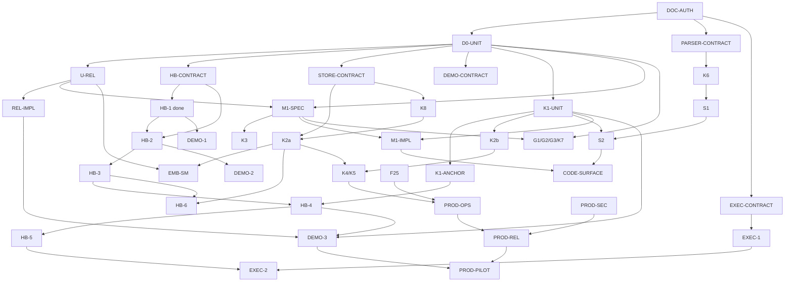

# Backlog Pi — terminar kimun desde el código actual

> **Read-only.** No se editó código, no se ejecutó la suite, no hay commit. Insumos:
> `docs/v2/12-ecosistema-y-pendientes.md`, `docs/v2/05-estado.md`, `docs/v2/06-superficies-y-cli.md`,
> `runs/research/2026-11-14/concilio/auditoria-spec.md`,
> `runs/research/2026-11-14/concilio/ambiguedades.md`, el roadmap anterior y el código de `src/`.
> El heartbeat que implementa Claude no se audita aquí; su revisión de código es una tarea separada.

## 0. Baseline y brechas

**Ya existe y no se rehace:** kernel formatos 2–4 (nodos, árboles, aristas, revisiones, anclajes,
reconciliación), Markdown, modelos, docs tipados, fields/sections, índice/find/corpus, edges/graph,
semantic, journal, diagnósticos, include, adaptadores, `migrate`, `serve`, packaging y
`stores sense --once` (observación read-only de una pasada).

**Evidencia disponible:** `runs/subagents/2026-11-14-sense/full-test.txt` registra la última suite
conocida (898 tests / 9.618 aserciones, 0 fallos). No se reejecuta ahora.

| Brecha | Qué falta | Bloquea |
|---|---|---|
| Identidad/unidad | no hay contrato en positivo de identidad, unidad, límite, continuidad ni relación con nodos S–M; `anchor` sigue resolviendo por nodo/posición y `reconcile` propone continuidad heurística | K1, K2b, S2, G1 |
| Relaciones/embeddings | no hay taxonomía declarable (jerárquica, horizontal, métrica, recursiva); embeddings están en G3 y no como capa continua por unidad | U-REL, EMB-SM, G3 |
| Heartbeat | `stores sense` es una sola observación; no hay ruta HTTP, daemon, épocas, deltas, activación asíncrona, causalidad ni coste incremental | HB-2…HB-6 |
| S–M | parser tree-sitter no es default seguro; K6 sin digest de contrato; K3 genéricos; M1 spec/impl; código como superficie | S1, S2, K3, M1, CODE-SURFACE |
| Store | K2a (Merkle por ruta) y K2b (quitar mmap/aristas redundantes) pendientes; plan del build sigue en CAS; contrato de verificación de caché | K2a, K2b, CACHE-VERIFY |
| Pruebas | no hay fixtures de continuidad mover/editar/copiar/dividir/fusionar/borrar, de contrato de parser, de heartbeat idempotente ni de activación asíncrona | todas las tareas de código |
| Demostración visual | no hay UI en el repo; `serve` es la única superficie visualizable y `graph_ui` externo no está migrado; `/health` resume `stores check`, no hay `/stores/sense` y la última señal visible es JSON | DEMO-1…3 |
| Autoridad documental | la auditoría detecta contradicciones en `01`, `02`, `05`, `12`, `14 §21` y en el spec/roadmap anterior | DOC-AUTH |
| Ejecuciones marcadas | no existe contrato de recibo/validador ni invalidación por dependencias | EXEC-1/2 |

## 1. DAG de trabajos

Cada fila es un nodo; `depends` son aristas. Los nodos de contrato no implementan: cierran
semántica, formato, errores y límites antes del código. El grafo siguiente es el resumen de
dependencias principales; la tabla es la fuente detallada.

### Contratos y gates

| id | trabajo | depends | criterio de aceptación |
|---|---|---|---|
| D0-UNIT | contrato positivo de identidad/unidad/continuidad; tabla de casos editar, mover, copiar, dividir, fusionar, borrar y cambio de contrato | auditoría + concilio | decisión del dueño o propuesta firmada; no reduce identidad a UUID, ruta, tema, rol, hash ni embedding; casos con resultado esperado y ambigüedad visible |
| U-REL | contrato de relaciones declarables: jerárquicas, horizontales, métricas, recursivas; frontera con embeddings continuos | D0-UNIT | tipos, cardinalidad, dirección, ciclos, consulta y evidencia definidos; `similitud ≠ relación validada`; embedding es capa aparte |
| HB-CONTRACT | contrato del heartbeat: señal, época, snapshot/delta, activación asíncrona, causalidad, ciclo de vida | D0-UNIT, U-REL | daemon con única función de recálculo; no ejecuta LLM, no muta grafo, no escala alertas; idempotencia y causalidad comprobables |
| EXEC-CONTRACT | contrato de ejecuciones marcadas: recibo, comando, resultado, dependencias, validador | D0-UNIT | distingue resultado histórico de vigencia actual; define qué comprueba el validador; puede declararse fuera del primer corte S–M |
| DOC-AUTH | resolver auditoría C1–C13, marcar spec/roadmap anteriores como históricos, corregir K1 “por lugar” | — | `01/02/05/12/14` sin contradicciones activas; autoridad explícita; enlaces y avisos de superación |
| STORE-CONTRACT | target K2a/K2b: Merkle por ruta, registro mínimo, migración/rollback, verificación de caché | K8, DOC-AUTH | formato, migración y rollback sin decisiones silenciosas; coste incremental medible; cache borrable y verificable |
| PARSER-CONTRACT | K6: digest de gramática/perfil/normalización/selector/clase y clases de drift | DOC-AUTH | `source-changed`, `contract-changed`, `parser-unavailable`, `rebuild-mismatch` distinguidos con fixtures |
| DEMO-CONTRACT | escenario visual reproducible y criterio de evidencia | D0-UNIT, HB-CONTRACT | tres comandos desde checkout limpio; JSON + captura; sin G ni afirmaciones de verdad |
| PROD-0 | límites operativos: plataformas, concurrencia, escala, SLO, recuperación, soporte | dueño | ADR con límites medibles y matriz de despliegue |

### Implementación S–M

| id | trabajo | depends | criterio de aceptación |
|---|---|---|---|
| K1-UNIT | registro de unidad: identidad propia, membrana, linaje, observación, contrato | D0-UNIT | mutación/movimiento conservan o rompen identidad según contrato; copia/división/fusión/borrado explícitos; migración/rebuild documentada |
| K1-ANCHOR | estados de observación/anclaje por unidad, no por mera existencia de nodo | K1-UNIT | estados `intact/superseded/orphan/ambiguous`; sin reanclaje silencioso; `stores sense` los consume |
| REL-IMPL | aristas y consultas para las cuatro familias de relación; herencia, temporal, secuencial | U-REL, K1-UNIT | consultas deterministas; ciclos y herencia probados; métricas declaradas separadas de embeddings |
| EMB-SM | capa continua derivada por unidad: modelo, versión, caché, señal `stale-embedding` | U-REL, K2a | no es identidad ni relación validada; cambiar modelo no rompe unidades; reconstruible sin GPU/red en el heartbeat |
| K2a | Merkle por ruta sobre lo trackeado; plan del build fuera del CAS | STORE-CONTRACT, K8 | cambio local baja por la rama afectada; borrar caché y reconstruir; coste medido |
| K2b | quitar mmap por ids internos y aristas redundantes por documento | K1-UNIT, K2a | store mínimo; `verify`/recuperación/rebuild conservan semántica; migración probada |
| K6 | digest de contrato de parse/selector | PARSER-CONTRACT | cuatro clases de drift con fixtures; caché invalida por contrato, no por sospecha |
| K8 | nombres cualificados por ruta; alias corto no ambiguo | STORE-CONTRACT | homónimos `a/README.md`/`b/README.md`, rename y enlaces cubiertos |
| S1 | cerrar divergencia tree-sitter/native o fijar default | K6 | corpus + propiedades; default justificado; pod reproducible |
| S2 | anchors por rango de bytes/CST a grafema NFC | K1-UNIT, S1 | conversión inequívoca; drift/reconcile por leaf y offsets Unicode |
| K3 | documentos sin modelo con clase genérica/perfil | M1-SPEC, parser definido | include/docs ingest; roundtrip de caché; clasificación explícita |
| M1-SPEC | spec 16: clase, perfil, selector, anclaje/generación, herencia, errores, migración | U-REL, DOC-AUTH | implementable sin decidir formato/semántica durante el coding |
| M1-IMPL | selector EDN, clases inmutables, anclaje y generación | M1-SPEC, P1, K1-UNIT | golden/property/negativos; paridad v1 reclasificada por feature/bug |
| CODE-SURFACE | código como superficie de modelos, además del adaptador de símbolos | M1-IMPL, S2 | un flujo de código de punta a punta con anchor a span/nodo y diagnóstico |
| P1 | separar `kimun.graph.*`; lint de anillos; partir `surface/docs` | DOC-AUTH | grafo depende de la base; lint impide inversión; superficies conservan contrato |
| F25 | atomicidad entre escritura de fuente y commit | DOC-AUTH | fallos I/O inyectados, edición concurrente, recuperación sin estado inconsistente |

### Heartbeat y activación

| id | trabajo | depends | criterio de aceptación |
|---|---|---|---|
| HB-1 | `stores sense --once` read-only (corte actual) | — | **hecho:** JSON/EDN/text, una observación, sin escritura, evidencia en `runs/subagents/2026-11-14-sense/` |
| HB-2 | exponer señales por HTTP y estabilizar esquema v1 | HB-CONTRACT, HB-1 | `GET /stores/sense` o equivalente; mismo contrato que CLI; sin escritura; errores y orden deterministas |
| HB-3 | daemon de latido: ciclo de vida, lock, start/stop, crash | HB-CONTRACT, HB-2 | única función de recálculo; no bloquea escritores; no deja estado inconsistente; idempotente; bajo `memcap` |
| HB-4 | activación asíncrona: épocas, cursores, snapshot/delta, reconexión | HB-3, K1-ANCHOR | consumidor desconectado no pierde novedades; dos latidos sin cambios no duplican; señal ≠ acción |
| HB-5 | causalidad y amortiguación: respuestas internas convergen sin bucles | HB-4 | `causation-id` o equivalente; una reparación interna pasa a `fresh/ack`, no dispara alerta idéntica |
| HB-6 | coste incremental: bajar solo por ramas Merkle cambiadas | K2a, HB-3 | latido medido sobre corpus; sin rescan completo; presupuesto y límites documentados |

### Ejecuciones, operación y demo

| id | trabajo | depends | criterio de aceptación |
|---|---|---|---|
| EXEC-1 | recibo pasivo de ejecución marcada | EXEC-CONTRACT | registro determinista de comando/exit/salida/huella; no infiere verdad de un exit code |
| EXEC-2 | invalidación por dependencias y vigencia del resultado | EXEC-1, HB-5 | cambio en dependencia invalida uso actual sin borrar el registro histórico |
| K4/K5 | packfiles e índice de nombres/GC | K2a, K2b | bytes/latencia medidos; GC no borra pins/heads/caché viva; verificación posterior |
| DEMO-1 | demo CLI canónica | HB-1, K1-ANCHOR | store temporal fuera del repo; antes/después de editar/mover; JSON + texto; reproducible |
| DEMO-2 | demo HTTP/visual | HB-2, DEMO-1 | `serve` + `/stores/sense`, `/graph`, `/edges`, `/health`; captura de pantalla o página estática; sin UI nueva en el núcleo |
| DEMO-3 | demo de continuidad y regulación | HB-4, K1-UNIT, REL-IMPL | mover+editar, copiar, dividir, borrar; señales y estado visible; ambigüedad visible; sin G |
| PROD-SEC | threat model de `serve`, paths, adapters, pods, secretos | PROD-0 | pruebas negativas por vector; SBOM/licencias |
| PROD-OPS | backup/restore, upgrade/rollback, corrupción, locks, disco lleno | PROD-0, K2a, K2b, F25 | runbooks ejecutados en entorno limpio; matriz de durabilidad |
| PROD-REL | CI con pods pinados, builds reproducibles, firma/checksums | S1, PROD-SEC | hashes iguales entre builds; bundle verificado por plataforma |
| PROD-PILOT | piloto integral en copia del desk/corpus | DEMO-3, PROD-REL, S/M/G integrado | informe con límites de éxito de PROD-0 |
| G1/G2/G3/K7 | capa G, consulta, embeddings de G, licencias | D0-UNIT, D-G, M1-SPEC, T01 | **no se diseña aquí**; empieza solo después del gate S–M |

## 2. Orden de ejecución recomendado

1. **Cerrar autoridad y contratos:** DOC-AUTH, D0-UNIT, U-REL, HB-CONTRACT, STORE-CONTRACT, PARSER-CONTRACT, DEMO-CONTRACT.
2. **Primer corte visible sin identidad nueva:** HB-2, DEMO-1 y DEMO-2 sobre lo ya implementado.
3. **Base S–M:** K8, K2a, K1-UNIT, K1-ANCHOR, REL-IMPL, EMB-SM.
4. **Latido completo:** HB-3, HB-4, HB-5, HB-6; después EXEC-1/2.
5. **Resto S/M:** K6, S1, S2, K3, M1, CODE-SURFACE, P1, F25.
6. **Operación:** K4/K5, PROD-SEC/OPS/REL/PILOT.
7. **G:** solo con gate S–M cerrado.

## 3. Estrategia de pruebas y demostración

- **Contrato:** fixtures de editar, mover, copiar, dividir, fusionar, borrar, cambio de parser y ambigüedad; cada una con estado esperado y salida visible.
- **Propiedades:** heartbeat idempotente; dos latidos sin cambios = mismo resultado; `sense` no escribe; ninguna similitud crea relación; ninguna copia conserva identidad por bytes.
- **Integración:** CLI + HTTP + daemon + lock + reconexión + crash; `serve` y `stores sense` comparten contrato.
- **Negativos:** archivo borrado, parser ausente, contrato cambiado, respuesta interna que no debe re-disparar, consumidor atrasado.
- **Visual:** un escenario de tres comandos, JSON antes/después y captura; no una maqueta que oculte que no hay G ni verdad de ejecución.
- **Evidencia:** `runs/subagents/<run>/` con `validation.log`, salidas JSON y captura; `bb lint`, `bb test`, `bb oracle` e `include check` antes del commit.

## 4. Límites explícitos

- No se declara aprobada la analogía VSM/autopoiesis como arquitectura; el heartbeat es una propuesta con función única.
- No se promete cobertura de todo cambio topológico: `stores sense` cubre las categorías de diagnósticos actuales.
- No se diseñan G, embeddings como identidad, ni ejecuciones como verdad automática.
- El código de heartbeat en curso no se revisa aquí; se hará en una revisión separada cuando Claude termine.
